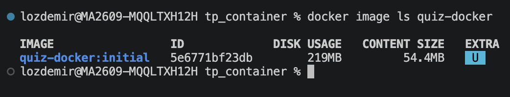
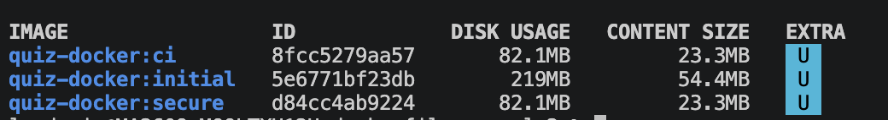

# Instructions pour l'exercice

Ce repository contient une application Node.js, et vous devez la faire fonctionner dans un conteneur.

Aucune modification de l'application ne devrait être nécessaire, seules les modifications du Dockerfile dans ce répertoire sont requises.


## A savoir

- Cet exercice est simplement conçu pour vous initier aux concepts de base des Dockerfile et ne se concentre pas trop sur l'utilisation correcte de Node.js dans un conteneur. 

## Audit de sécurité du quiz

L'image de départ s'appelle `quiz-docker:initial`. Elle a été construite à partir du
`Dockerfile` de cet exercice. Son identifiant affiché par Docker est `5e6771bf23db`
et sa taille est d'environ 219 Mo.

L'assistant a effectué ces vérifications le 16 novembre 2026. Elles servent de
point de départ pour comparer l'image sécurisée.

| Point vérifié | Ce qui a été observé | Amélioration à étudier |
| --- | --- | --- |
| Image de base | `node:18-alpine` fournit Node.js 18.20.8 et Alpine 3.21.3. Node 18 est en fin de maintenance et Trivy indique que cette version d'Alpine est en fin de support. | Utiliser une image maintenue pour la construction et une image légère et maintenue pour le serveur final. |
| Version de l'image | Le tag `18-alpine` indique une famille de versions. Il peut être mis à jour. | Choisir des versions précises et les mettre à jour régulièrement. Un digest `sha256` permet de fixer exactement une image. |
| Fichiers copiés | `COPY . .` copie le contenu du dossier de l'exercice dans l'image. Au moment de l'audit initial, il n'y avait pas de `.dockerignore` pour cet exercice. | Créer un `.dockerignore` pour exclure les fichiers inutiles ou sensibles, comme `node_modules`, `.env` et les journaux éventuels. |
| Construction et exécution | Le quiz est construit dans la même image que celle qui le sert. Après le nettoyage de `node_modules` du projet, Node, npm et le serveur `serve` restent présents dans l'image. | Utiliser un build en plusieurs étapes pour construire le quiz, puis copier `dist/` vers une image de serveur léger. |
| Dépendances | Le projet contient un `package-lock.json`. La commande `npm install -g serve` ne précise pas la version du serveur. | Essayer `npm ci` pour installer les dépendances à partir du fichier de verrouillage et choisir une version précise pour les outils utilisés. |
| Utilisateur | Le processus principal du conteneur `quiz-exo2` s'exécute avec l'identifiant `0`, qui correspond à `root`. | Faire tourner le serveur avec un utilisateur disposant de moins de droits. |
| Fichiers du conteneur | La racine du système de fichiers est accessible en écriture. | Tester l'option `--read-only` et fournir un dossier temporaire accessible en écriture si le serveur en a besoin. |
| Ressources | Aucune limite de mémoire ou de CPU n'est définie pour ce conteneur. | Tester des limites adaptées avec `--memory` et `--cpus`. |
| Privilèges | Le conteneur utilise `privileged=false`. Aucune capacité Linux n'a été explicitement retirée. | Tester le retrait des capacités inutiles et l'option `no-new-privileges`. |
| Socket Docker | Aucun montage du socket Docker n'a été observé dans le conteneur du quiz. | Garder uniquement les accès nécessaires au fonctionnement du quiz. |
| Port | L'application écoute sur le port interne `3000`. Le conteneur actuel publie `127.0.0.1:8089` sur le Mac. | Conserver uniquement les ports nécessaires et vérifier leur exposition au démarrage. |

`EXPOSE 3000` indique le port utilisé par l'application dans le conteneur. C'est
l'option `-p` de `docker run` qui publie un port sur la machine.

### Résultat de l'analyse Trivy initiale

Trivy recherche des vulnérabilités connues dans les composants de l'image.
L'analyse de l'image initiale a donné les résultats suivants.

| Gravité | Signalements |
| --- | ---: |
| Critique | 3 |
| Élevée | 43 |
| Moyenne | 55 |
| Faible | 38 |
| Total | 139 |

Un même identifiant de vulnérabilité peut apparaître plusieurs fois s'il touche
plusieurs paquets. Les 139 signalements correspondent à 90 identifiants
distincts. Trivy indique aussi que la détection peut être incomplète pour cette
version d'Alpine.

Le [rapport initial au format JSON](rapports/trivy-initial.json) est enregistré
dans le dossier `rapports` du projet. Le format JSON est un format de données
lisible par les outils.

### Refaire l'analyse avec Trivy

Docker Desktop doit être démarré. La première commande enregistre une copie de
l'image dans une archive temporaire.

```bash
docker image save -o /tmp/quiz-docker-initial.tar quiz-docker:initial
```

La commande suivante lance Trivy dans un conteneur et lui donne accès à cette
archive en lecture seule.

```bash
docker run --rm \
  -v /tmp/quiz-docker-initial.tar:/image.tar:ro \
  aquasec/trivy:0.76.2 image \
  --input /image.tar --scanners vuln --severity HIGH,CRITICAL --no-progress
```

- `--rm` supprime le conteneur Trivy quand il a terminé.
- `-v ...:ro` rend l'archive disponible en lecture seule dans ce conteneur.
- `image --input /image.tar` demande à Trivy d'analyser cette archive d'image.
- `--scanners vuln` recherche les vulnérabilités.
- `--severity HIGH,CRITICAL` affiche les niveaux élevé et critique. Retirer cette
  option pour voir aussi les niveaux moyen et faible.
- `--no-progress` masque la barre de progression.

Dans le résultat, `Vulnerability` donne l'identifiant du problème, `Severity`
indique sa gravité, `Installed Version` montre la version installée et
`Fixed Version` indique une version corrigée lorsqu'elle est connue. Les
résultats peuvent évoluer lorsque la base de vulnérabilités est mise à jour.

Après la création de `quiz-docker:secure`, refaire l'export et l'analyse de cette
nouvelle image, puis comparer les résultats avec ceux de l'image initiale.

Sources : [documentation Trivy](https://trivy.dev/docs/latest/references/configuration/cli/trivy_image/),
[versions de Node.js](https://nodejs.org/en/about/previous-releases) et
[builds Docker en plusieurs étapes](https://docs.docker.com/build/building/multi-stage/).

## Image sécurisée et comparaison

Le `Dockerfile.secure` construit le quiz avec Node.js, puis copie le dossier
`dist/` dans une image Nginx qui tourne avec l'utilisateur `101`. Pendant la
construction de l'image Nginx, `zlib` est mis à jour pour corriger le problème
relevé par Trivy. Le `.dockerignore` exclut notamment les fichiers `.env`, les
dépendances locales et les dossiers générés.

### Ce que change le Dockerfile sécurisé

| Élément | Dockerfile initial | Dockerfile sécurisé et raison |
| --- | --- | --- |
| Image de construction | `node:18-alpine`, avec Node 18 en fin de maintenance. | `node:24.22.3-alpine AS build` utilise une version maintenue et donne le nom `build` à l'étape de construction. |
| Installation | `npm install` installe les dépendances du projet. | `npm ci` utilise les versions indiquées dans `package-lock.json`. Les fichiers de dépendances sont copiés avant le reste du code pour faciliter l'utilisation du cache Docker. |
| Construction | Le quiz est construit et servi dans une même image. | `npm run build` produit le site dans `/app/dist`. Une deuxième étape récupère ce dossier avec `COPY --from=build`. |
| Serveur | Le serveur `serve` fonctionne avec Node.js sur le port interne `3000`. | Nginx sert les fichiers construits sur le port interne `8080`. Node.js et npm restent dans l'étape de construction. |
| Correctif | L'image initiale contenait `zlib` 1.3.1-r2. | Dans l'image Nginx, `apk add --no-cache --upgrade zlib` a installé la version corrigée 1.4-r0 lors de notre construction. |
| Utilisateur | Le serveur démarre avec `root`. | `USER 101:101` démarre le serveur avec l'utilisateur 101 et le groupe 101, qui ont moins de droits. |
| Démarrage | `CMD ["serve", "-s", "dist"]` lance le serveur Node.js. | `CMD ["nginx", "-g", "daemon off;"]` garde le serveur Nginx au premier plan dans le conteneur. |

`FROM nginx/nginx-unprivileged:1.30.6-alpine` utilise une image publiée par
NGINX Inc. sur Docker Hub. `nginx` est le nom de l'éditeur,
`nginx-unprivileged` le nom de l'image et `1.30.6-alpine` son tag de version.
Cette image est prévue pour exécuter Nginx avec un utilisateur limité et son
port par défaut est `8080`. [Image NGINX Unprivileged](https://hub.docker.com/r/nginx/nginx-unprivileged)

L'utilisateur `nginx` et le groupe `nginx` sont créés lors de la construction de
l'image de base par les développeurs de NGINX. Ils leur donnent respectivement
les numéros d'utilisateur et de groupe `101` avec les commandes `adduser` et
`addgroup`. [Dockerfile de l'image NGINX](https://github.com/nginx/docker-nginx-unprivileged/blob/main/stable/alpine-slim/Dockerfile)

Notre instruction `FROM` récupère cette image avec son utilisateur et son groupe.
`USER root` sert pendant notre construction à mettre `zlib` à jour. La ligne
`USER 101:101` sélectionne ensuite l'utilisateur et le groupe déjà présents pour
le démarrage du conteneur. [Instruction Docker USER](https://docs.docker.com/reference/dockerfile/#user)

Pour observer le compte présent dans l'image NGINX, exécuter :

```bash
docker run --rm --entrypoint id nginx/nginx-unprivileged:1.30.6-alpine
```

| Vérification | Image initiale | Image sécurisée |
| --- | --- | --- |
| Image | `quiz-docker:initial` | `quiz-docker:secure` |
| Taille affichée par Docker | 219 Mo | 82,1 Mo |
| Utilisateur du serveur | `root` | `101` |
| Node et npm dans l'image finale | Présents | Absents |
| Signalements Trivy critiques | 3 | 0 |
| Signalements Trivy élevés | 43 | 0 |
| Signalements Trivy moyens | 55 | 0 |
| Signalements Trivy faibles | 38 | 0 |

### Comparaison visuelle de la taille

Avant, l'image initiale occupait 219 Mo selon la colonne `DISK USAGE` de Docker.



Après la correction, l'image sécurisée occupe 82,1 Mo selon la même colonne.



Les deux analyses ont été réalisées le 16 novembre 2026 avec Trivy 0.76.2. Le
[rapport de l'image sécurisée](rapports/trivy-secure.json) est enregistré dans
le dossier `rapports` du projet. Les résultats d'un scan
peuvent évoluer avec les mises à jour de la base de vulnérabilités.

Pendant la construction, `npm ci` signale séparément 6 vulnérabilités dans les
dépendances de développement du projet : 5 élevées et 1 modérée. Elles restent à
examiner dans le fichier de verrouillage, même si les outils de construction ne
sont pas installés dans l'image finale.

### Construire et lancer l'image sécurisée

Depuis le dossier `dockerfile-exercice2`, construire l'image avec cette commande.

```bash
docker build -f Dockerfile.secure -t quiz-docker:secure .
```

Pour créer le conteneur la première fois, utiliser la commande suivante. Le
réseau `tp-containers` doit avoir été créé avec `docker network create tp-containers`.

```bash
docker run -d --name quiz-securise \
  --network tp-containers \
  -p 127.0.0.1:8090:8080 \
  --read-only \
  --tmpfs /tmp:rw,noexec,nosuid,size=16m \
  --cap-drop ALL \
  --security-opt no-new-privileges:true \
  --memory 128m --cpus 0.5 --pids-limit 100 \
  quiz-docker:secure
```

Ouvrir ensuite [le quiz sur le port 8090](http://localhost:8090). Les options de
`docker run` ajoutent les limites au conteneur créé. `--tmpfs` fournit à Nginx un
dossier temporaire en mémoire pour ses fichiers de travail.

Le conteneur `quiz-securise` créé pour le test peut être arrêté avec
`docker stop quiz-securise` et redémarré avec `docker start quiz-securise`.

## Utiliser le quiz sur Azure

Le quiz utilise trois ressources dans le groupe `tp_container` :

| Ressource | Nom | Rôle |
| --- | --- | --- |
| Azure Container Registry | `lozdemir` | Stocke les images Docker. |
| Identité managée | `quiz-aci-identity` | Permet à l'instance de lire les images du registre grâce au rôle `AcrPull`. |
| Azure Container Instances | `quiz-docker-aci` | Exécute le conteneur du quiz. |

Le registre conserve l'image ; l'instance la récupère et lance le conteneur.
L'identité Azure sert à accéder au registre. Elle est différente de l'utilisateur
`101`, qui exécute Nginx à l'intérieur du conteneur.

Les commandes qui commencent par `az` ci-dessous se lancent dans **Cloud Shell** :
ouvrir le [portail Azure](https://portal.azure.com/), cliquer sur l'icône
**Cloud Shell** en haut et choisir **Bash**. Les commandes `docker`, elles, se
lancent dans le terminal du Mac, avec Docker Desktop démarré.

Avant de commencer, vérifier l'abonnement sélectionné dans Cloud Shell :

```bash
az account show --query '{abonnement:name,etat:state}' --output table
```

Pour ce TP, l'abonnement utilisé était `Azure for Students`. Si ce n'est pas
celui affiché, sélectionner le bon abonnement dans le portail ou avec
`az account set --subscription "Azure for Students"`.

### Voir le registre, les images et l'instance

Ces deux commandes affichent les dépôts d'images du registre et les tags du quiz :

```bash
az acr repository list --name lozdemir --output table
az acr repository show-tags --name lozdemir --repository quiz-docker --output table
```

Un **tag**, comme `secure` ou `v2`, est un nom donné à une version d'image.
Pour lister les instances du groupe, puis voir l'état et l'adresse du quiz :

```bash
az container list --resource-group tp_container --output table
az container show \
  --resource-group tp_container \
  --name quiz-docker-aci \
  --query '{etat:instanceView.state,ip:ipAddress.ip}' \
  --output table
```

`Running` signifie que l'instance fonctionne ; `Stopped` signifie qu'elle est
arrêtée. Pour ouvrir ou partager le quiz pendant son fonctionnement, former
l'adresse `http://<adresse-ip>:8080/` avec l'IP affichée. Le port `8080` est
celui utilisé par Nginx. L'adresse est publique et utilise HTTP, sans
chiffrement : ne pas y saisir de données personnelles.

Pour afficher les messages du serveur, appelés **logs** :

```bash
az container logs \
  --resource-group tp_container \
  --name quiz-docker-aci \
  --container-name quiz-docker
```

### Arrêter et redémarrer l'instance

Dans Cloud Shell, arrêter l'instance quand le quiz n'est plus utilisé :

```bash
az container stop --resource-group tp_container --name quiz-docker-aci
```

La commande arrête le conteneur Azure ; le quiz n'est alors plus accessible.
Quand le groupe est arrêté, sa facturation de calcul s'arrête. Le registre
`lozdemir` reste une ressource séparée et continue d'avoir son propre coût.

Pour redémarrer le quiz plus tard :

```bash
az container start --resource-group tp_container --name quiz-docker-aci
```

Le démarrage reprend la facturation de l'instance. L'IP peut changer : refaire
la commande `az container show` ci-dessus avant de partager le lien. On peut
aussi utiliser les boutons **Stop** et **Start** dans la page
`quiz-docker-aci` du portail.
[Documentation Microsoft](https://learn.microsoft.com/fr-fr/azure/container-instances/container-instances-stop-start)

### Mettre une nouvelle version du quiz sur Azure

Modifier le code en local ne modifie pas l'image déjà utilisée par Azure. Il
faut construire une nouvelle image, l'envoyer dans un registre, puis mettre
l'instance à jour. L'exemple suivant passe par Docker Hub, comme pour notre
premier déploiement. Il est aussi possible d'envoyer l'image directement dans
Azure Container Registry après s'y être authentifié depuis le Mac.

Dans cet exemple, `v2` est un nouveau tag. Choisir un tag jamais utilisé pour
chaque version, par exemple `v3` pour la suivante.

#### 1. Construire et tester sur le Mac

Dans le terminal du Mac, depuis le dossier `dockerfile-exercice2` :

```bash
docker buildx build \
  --platform linux/amd64 \
  --load \
  -f Dockerfile.secure \
  -t luboys/quiz-docker:v2 \
  .
```

`--platform linux/amd64` construit pour l'architecture prise en charge par
Azure Container Instances. `--load` rend l'image disponible dans Docker sur le
Mac. `-f` choisit le Dockerfile et `-t` donne le nom et le tag à l'image.

Tester la nouvelle image localement :

```bash
docker run -d --rm --name quiz-v2-test \
  -p 127.0.0.1:8093:8080 \
  luboys/quiz-docker:v2
```

Ouvrir [le quiz de test](http://127.0.0.1:8093/), puis l'arrêter :

```bash
docker stop quiz-v2-test
```

L'option `--rm` supprime le conteneur de test après son arrêt ; l'image reste
sur le Mac. Si le résultat convient, publier l'image sur Docker Hub :

```bash
docker push luboys/quiz-docker:v2
```

La commande suppose que Docker est connecté au compte `luboys`. Le dépôt Docker
Hub utilisé pour le TP est public : son image peut être téléchargée par d'autres.

#### 2. Importer l'image dans le registre Azure

Dans **Cloud Shell**, copier l'image de Docker Hub vers `lozdemir` :

```bash
az acr import \
  --name lozdemir \
  --source docker.io/luboys/quiz-docker:v2 \
  --image quiz-docker:v2
```

`--source` désigne l'image sur Docker Hub ; `--image` choisit son nom dans le
registre Azure. Cette commande copie l'image, mais ne met pas encore l'instance
à jour. [Documentation Microsoft](https://learn.microsoft.com/en-us/azure/container-registry/container-registry-import-images)

#### 3. Récupérer la configuration de l'instance

Le fichier utilisé pour le premier déploiement s'appelait
`/tmp/quiz-aci-template.json` dans Cloud Shell. Cette session est temporaire :
le fichier peut disparaître à sa fermeture et n'est pas enregistré dans ce dépôt.

Azure garde le modèle utilisé dans l'historique du déploiement
`quiz-aci-deploy`. Pour le récupérer dans un nouveau fichier temporaire :

```bash
az deployment group export \
  --resource-group tp_container \
  --name quiz-aci-deploy \
  --output json > /tmp/quiz-aci-v2.json
```

Ce modèle correspond à la configuration du **premier déploiement**. Si des
paramètres de l'instance ont été modifiés depuis, les vérifier avant de le
réutiliser. Pour conserver une copie sur le Mac, utiliser **Manage files →
Download** dans Cloud Shell. [Documentation Microsoft](https://learn.microsoft.com/en-us/azure/azure-resource-manager/templates/export-template-cli)

#### 4. Choisir l'image et redéployer

L'instance actuelle utilise une **empreinte** `sha256`, appelée aussi digest :
elle désigne une image précise. Même si un tag change, cette empreinte reste
liée à la même image. Pour connaître l'empreinte du tag `v2` dans Azure :

```bash
az acr repository show \
  --name lozdemir \
  --image quiz-docker:v2 \
  --query digest \
  --output tsv
```

Si le tag correspond à une liste de plusieurs manifestes, choisir plutôt
l'empreinte du manifeste **linux/amd64**. La commande suivante, lancée sur le
Mac après le `docker push`, permet de voir les plateformes et leurs empreintes :

```bash
docker buildx imagetools inspect luboys/quiz-docker:v2
```

Dans Cloud Shell, ouvrir le modèle récupéré :

```bash
code /tmp/quiz-aci-v2.json
```

Dans la propriété `image` du conteneur, remplacer seulement l'ancienne
empreinte par celle de la nouvelle image. Conserver l'adresse du registre et
`quiz-docker@` devant l'empreinte :

```text
lozdemir-b0hzgeaaaxd8debj.azurecr.io/quiz-docker@<digest-v2>
```

Remplacer `<digest-v2>` par la valeur complète, `sha256:` compris, sans les
signes `<` et `>`, puis enregistrer le fichier.
Ne pas modifier l'identité, le nom de l'instance, la mémoire ou les autres
réglages sans vérifier leur effet. Vérifier le modèle :

```bash
az deployment group validate \
  --resource-group tp_container \
  --template-file /tmp/quiz-aci-v2.json \
  --query properties.provisioningState \
  --output tsv
```

Si le résultat est `Succeeded`, lancer le déploiement :

```bash
az deployment group create \
  --resource-group tp_container \
  --name quiz-aci-v2 \
  --template-file /tmp/quiz-aci-v2.json
```

La validation vérifie le modèle avant le déploiement ; elle ne garantit pas à
elle seule que l'application démarrera correctement. Le déploiement utilise le
nom `quiz-docker-aci` présent dans le modèle, démarre ou redémarre l'instance et
peut changer son IP. Vérifier ensuite son état, son adresse et le quiz dans le
navigateur. L'instance en fonctionnement consomme des crédits Azure.
[Documentation Microsoft](https://learn.microsoft.com/en-us/azure/container-instances/container-instances-update)

Le workflow [GitHub Actions](../.github/workflows/quiz-docker.yml) construit et
teste l'image lors d'un push sur `main`, d'une pull request vers `main` ou d'un
lancement manuel. Pour l'instant, il ne publie pas l'image et ne met pas Azure
à jour : les étapes de publication et de déploiement ci-dessus sont manuelles.
